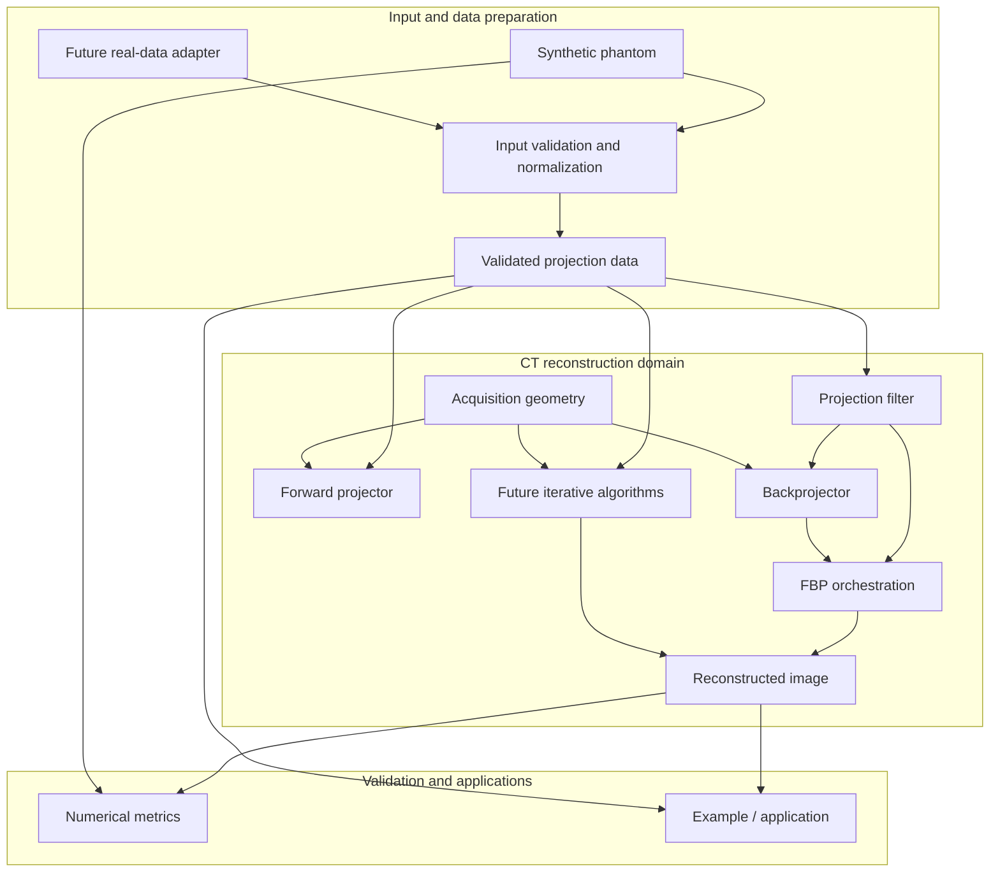
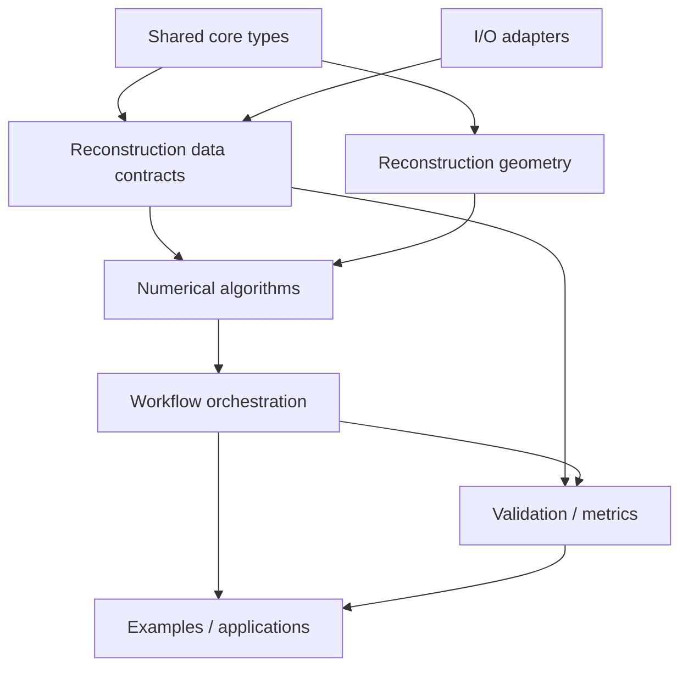
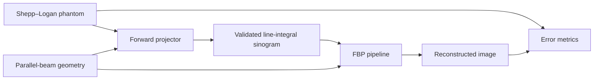

# CT Reconstruction Domain Architecture

- Backlog ID: DOC-02
- Related issue: #34
- Depends on: #33 — DOC-01
- Status: Architecture proposal
- Scope: Initial 2D parallel-beam CT reconstruction

## 1. Purpose

This document defines how the CT reconstruction domain fits into ImageRegistration, including module responsibilities, dependency direction, data flow, and integration boundaries.

The initial end-to-end workflow is:

> Shepp–Logan phantom → forward projection → validated sinogram → filtering → backprojection → reconstructed image → numerical validation

The architecture must support this workflow without coupling reconstruction to the existing image-registration algorithms or to scanner-specific input/output systems.

This document defines architectural responsibilities and boundaries. It does not claim that the proposed reconstruction components have already been implemented.

## 2. Architectural principles

1. Separate domains: Image registration and CT reconstruction are independent domains within the same repository.
2. Data before algorithms: Define image, geometry, and projection-data contracts before implementing reconstruction algorithms.
3. Composition over inheritance: Assemble focused components instead of building a monolithic reconstruction class.
4. Dependency inversion: Algorithms depend on stable data contracts and narrow interfaces, not concrete file readers or visualization frameworks.
5. Minimal dependencies: Keep the reconstruction core compatible with the existing C++20, CMake, Eigen, and Catch2 conventions.
6. Explicit semantics: Distinguish spatial image geometry, scanner acquisition geometry, projection measurements, and reconstructed image values.
7. Incremental evolution: Implement 2D parallel-beam reconstruction first; introduce other geometries and dimensions through separately designed extensions.
8. Testability: Each numerical stage must be independently testable and deterministic for fixed inputs and configuration.

## 3. High-level module architecture



### Interpretation

- Synthetic and future real-data inputs are prepared through separate input paths.
- Both paths must produce projection data with validated dimensions, sampling, and acquisition geometry before algorithms consume it.
- FBP and iterative reconstruction are different algorithm compositions, not modes hidden inside one monolithic algorithm.
- Metrics and examples consume public data contracts and do not own reconstruction algorithms.
- The diagram represents the target architecture, not a claim that all modules currently exist.

## 4. Module responsibilities

| Module | Responsibility | Must not own |
| --- | --- | --- |
| Existing core types (`ir::Image2D`, `ir::ImageGeometry2D`) | Shared image and spatial geometry contracts used by reconstruction | CT scanner acquisition logic or reconstruction orchestration |
| `ir::io` | Existing and future input/output abstractions and adapters | Numerical reconstruction algorithms |
| Reconstruction data and geometry | New sinogram and parallel-beam acquisition contracts; reuse `ir::Image2D` and `ir::ImageGeometry2D` for spatial images | Duplicate image types, file-format parsing, or application UI |
| Reconstruction geometry | Define parallel-beam acquisition coordinates, projection angles, detector sampling, and conventions | Image registration transforms unless their semantics genuinely match |
| Phantom generation | Generate deterministic synthetic test objects | Scanner-specific acquisition simulation |
| Forward projector | Convert an image and acquisition geometry into idealized line-integral projections | File I/O, filtering, or backprojection |
| Projection filter | Apply the specified detector-axis filter to compatible projection data | Acquisition geometry creation or image reconstruction orchestration |
| Backprojector | Map compatible projection data into a spatial image using declared geometry | Input parsing or unrelated registration algorithms |
| FBP orchestration | Compose filtering and backprojection with consistent geometry and configuration | Owning every numerical implementation |
| Future iterative algorithms | Compose projection and backprojection operations into iterative workflows | Changing the meaning of existing FBP contracts |
| Validation and metrics | Evaluate numerical correctness, image error, and deterministic behavior | Altering algorithm output silently |
| Examples / applications | Configure and demonstrate end-to-end workflows | Defining hidden numerical conventions |

These responsibilities describe logical boundaries. They do not require a separate class, library, or directory for every row.

## 5. Proposed public API organization

New reconstruction-specific public APIs belong under `include/ir/reconstruction/`. Reuse the existing `include/ir/core/Image2D.hpp` and `include/ir/core/ImageGeometry2D.hpp` rather than adding reconstruction-specific image or image-geometry types. Existing core headers use the `ir` namespace; `ir::core` is a header-directory name, not a C++ namespace.

A possible organization, using the repository's PascalCase header naming convention, is:

```text
include/
  ir/
    core/
      Image2D.hpp                 # Existing; reuse
      ImageGeometry2D.hpp         # Existing; reuse
    io/
      # Existing I/O headers
    metric/
      # Existing metrics; reuse where definitions and inputs fit
    reconstruction/
      ParallelBeamGeometry2D.hpp
      Sinogram2D.hpp
      SheppLoganPhantom2D.hpp
      ForwardProjector2D.hpp
      RampProjectionFilter.hpp
      Backprojector2D.hpp
      FilteredBackprojection2D.hpp
```

The reconstruction headers above are proposals, not existing files. `Image2D` and `ImageGeometry2D` already provide spatial image storage and geometry; reconstruction should define acquisition geometry and projection data separately. Prefer existing metrics such as `MeanSquaresMetric2D` when their definitions fit, rather than adding a duplicate generic validation or image-error API. Confirm proposed names and contracts against the repository before implementation.

Implementation details should remain outside the public headers where practical:

```text
src/
  reconstruction/
    # Numerical implementations, if needed
tests/
  reconstruction/
    # Unit and integration tests
examples/
  reconstruction/
    # Reproducible demonstrations
docs/
  architecture/
    reconstruction-domain.md
```

This is a proposed organization, not a requirement to create all listed files in DOC-02.

## 6. Dependency rules

The dependency graph must remain directed and acyclic.

### 6.1 Allowed dependency direction



Arrows indicate conceptual dependency or use. The implementation may organize these components differently, provided the dependency constraints are preserved.

### 6.2 Dependency constraints

- Shared core: Must not depend on reconstruction, registration algorithms, DICOM, visualization, or GUI frameworks.
- Reconstruction data: May reuse shared image and mathematical types, but must not depend on file readers or application code.
- Geometry: Must define acquisition conventions explicitly and must not depend on reconstruction orchestration.
- Numerical algorithms: Must consume explicit inputs and return documented results; they must not open files or access global application state.
- Orchestration: May compose numerical stages but must not require a concrete I/O implementation.
- I/O adapters: May translate external data into domain contracts but must not own reconstruction mathematics.
- Metrics: Must operate on documented data contracts and remain independently testable.
- Applications: May compose the domain, adapters, and metrics, but must not introduce reverse dependencies into the core.

No circular dependency is permitted between data contracts, geometry, algorithms, and orchestration.

## 7. Synthetic and real-data workflows

### 7.1 Synthetic projection path



The synthetic path starts from an image and computes idealized line-integral projections. It does not represent raw detector counts or require DICOM input.

### 7.2 Future real-data path


A real-data adapter must establish the measurement semantics before creating the domain representation. Raw detector counts, corrected transmission measurements, logarithmic line integrals, and reconstructed CT images are different data products.

The adapter must not silently reinterpret one as another.

A conventional DICOM CT image series is reconstructed spatial image data, not a projection sinogram. A suitable real-data source must provide projection/acquisition information or a separately justified conversion workflow.

Real-data support, DICOM parsing, and DICOM-CT-PD validation are outside DOC-02's implementation scope.

### 7.3 Convergence contract

Both paths must satisfy the same downstream projection-data contract when they represent the same mathematical quantity.

The contract must document:

- Detector and view dimensions.
- Detector-axis and view-axis ordering.
- Projection angle units and ordering.
- Detector spacing and coordinate conventions.
- Measurement semantics and units or scaling.
- Associated acquisition geometry.
- Invalid-value and compatibility rules.

The specific fields and validation mechanisms belong to the data-model issue, DOC-03 (#35). DOC-02 establishes the architectural boundary without prematurely defining the complete concrete type.

## 8. FBP and iterative reconstruction

### 8.1 Filtered backprojection

FBP is a composition of a projection filter and a backprojection operation:

```text
Validated projection data
        |
        v
Ramp filtering along detector axis
        |
        v
Backprojection using compatible geometry
        |
        v
Reconstructed image
```

The architecture must preserve the ability to test the filter and backprojector independently. FBP orchestration should coordinate the stages and configuration without duplicating their numerical implementations.

### 8.2 Future iterative reconstruction

Iterative methods use a different workflow:

```text
Initial image estimate
        |
        v
Forward projection
        |
        v
Compare with measured projections
        |
        v
Update image estimate
        |
        v
Repeat according to algorithm configuration
```

Future methods such as ART or SART may reuse compatible geometry and projection contracts. They must not be represented as simple aliases for FBP or forced into the same fixed filter-then-backproject sequence.

Iterative reconstruction remains outside the initial M0–M1 implementation scope unless introduced by a separate backlog issue.

## 9. Integration with existing ImageRegistration components

### 9.1 Core image and geometry types

- Reuse `ir::Image2D` and `ir::ImageGeometry2D` from `include/ir/core/` for spatial images and their geometry.
- Do not make shared core types depend on CT-specific concepts.
- Do not add acquisition metadata to a generic image type solely to satisfy reconstruction requirements.
- Add reconstruction-specific types only for distinct concepts, such as parallel-beam acquisition geometry and a sinogram.
- Note that the current core headers declare types in namespace `ir`; `ir::core` is not a namespace.

### 9.2 `ir::io`

- Keep file parsing and external-format translation at the I/O boundary.
- The numerical reconstruction pipeline must be testable without files or external datasets.
- Future adapters should translate source data into validated domain types.
- Do not add DICOM dependencies to the core or reconstruction algorithms.

### 9.3 Image registration

- Registration and reconstruction remain independent domains.
- Registration estimates spatial relationships between images; reconstruction estimates an image from projection measurements.
- They may reuse appropriate image, geometry, and mathematical primitives.
- Neither domain should require the other domain's algorithms to build or run.

### 9.4 Metrics and validation

- Reuse existing metrics, including `ir::MeanSquaresMetric2D`, only when their definitions and inputs are appropriate.
- Reconstruction-specific validation may compare a reconstructed image with a known synthetic reference.
- Keep synthetic phantom generation and acceptance-test helpers out of core image and geometry types.
- Algorithm tests must not depend on visualization or GUI output.
- Numerical thresholds must be justified by sampling, discretization, interpolation, and normalization conventions.

### 9.5 Build and test integration

- Preserve the project's C++20 and CMake conventions.
- Use Eigen for linear algebra where appropriate.
- Use Catch2 for unit and integration tests.
- Avoid converting the entire interface library into compiled code without evidence that this is necessary.
- Keep the existing registration tests and build behavior intact when reconstruction is added.

## 10. Error handling and compatibility

The architecture must support explicit handling of invalid or incompatible inputs, including:

- Invalid image dimensions or spacing.
- Invalid detector sampling or projection angles.
- Inconsistent sinogram dimensions and acquisition geometry.
- Unsupported acquisition geometry.
- Invalid or non-finite values where the relevant contract prohibits them.

Error behavior must follow established repository conventions. DOC-02 does not prescribe a new global exception hierarchy or error framework without examining the existing implementation.

A component must not silently repair or reinterpret incompatible projection data in a way that changes its physical or mathematical meaning.

## 11. Testing strategy for the architecture

The architecture must make the following tests possible as implementation progresses:

| Test level | Responsibility |
| --- | --- |
| Data-contract tests | Verify dimensions, metadata consistency, and invalid-input handling |
| Geometry tests | Verify angle, detector sampling, and coordinate conventions |
| Forward-projector tests | Verify deterministic projection generation for synthetic inputs |
| Filter tests | Verify detector-axis behavior, output dimensions, and finite results |
| Backprojector tests | Verify output geometry and finite results |
| FBP integration tests | Verify end-to-end synthetic reconstruction and numerical error |
| Adapter tests | Verify conversion from supported external data into the domain contract |
| Build integration tests | Verify registration remains independent and existing tests continue to pass |

These test categories guide later implementation issues; this documentation task does not require production algorithms to be implemented.

## 12. Evolution strategy

| Milestone | Architectural focus |
| --- | --- |
| M0 | Data contracts, image geometry, parallel-beam acquisition geometry, phantom, and project skeleton |
| M1 | Forward projector, ramp filter, backprojector, FBP orchestration, metrics, and synthetic validation |
| M2 | Sparse-view experiments, noise models, and iterative reconstruction as separately designed workflows |
| M3 | Real-data investigation, appropriate projection-data adapters, and DICOM-CT-PD evaluation |
| M4 | Performance baselines, benchmarks, and evidence-driven optimization |
| Later | Fan-beam, cone-beam, 3D reconstruction, and other modalities through separate design decisions |

Future phases must extend the architecture without changing the meaning of established data contracts silently.

## 13. Acceptance criteria

DOC-02 is complete when:

- [ ] Every logical module has one documented responsibility.
- [ ] Allowed dependencies and dependency direction are documented.
- [ ] The architecture is acyclic.
- [ ] Synthetic and future real-data paths converge on a validated projection representation.
- [ ] FBP and iterative workflows are represented as distinct compositions.
- [ ] Integration boundaries with existing core image/geometry types, `ir::io`, registration, acquisition geometry, and metrics are explicit.
- [ ] Public API responsibilities are distinguished from implementation details.
- [ ] The design follows existing C++20, CMake, Eigen, and Catch2 conventions.
- [ ] The architecture does not require speculative factories, plugin systems, generic N-dimensional templates, GPU support, or unrelated dependencies.
- [ ] Existing registration functionality remains independent.
- [ ] The document does not claim that proposed components are already implemented.

## 14. Definition of done

The architecture document is reviewed against the current repository structure, naming conventions, and existing types. Any proposed directory or interface that conflicts with existing implementation is reconciled before downstream implementation issues depend on it.

The resulting architecture provides a stable direction for DOC-03 (#35), DOC-04 (#36), and subsequent reconstruction implementation issues without prematurely locking down every class or function signature.